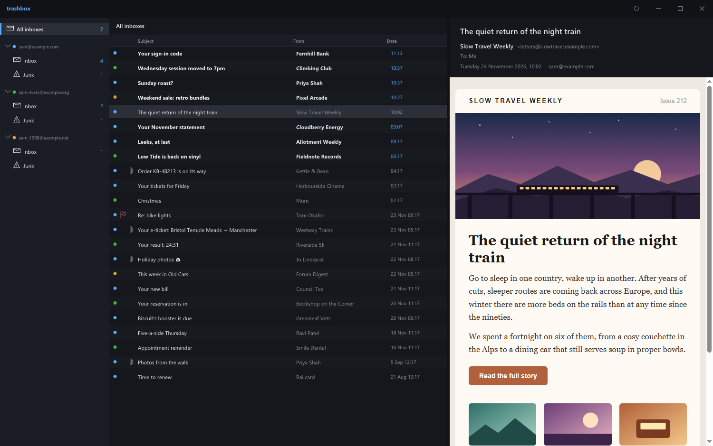
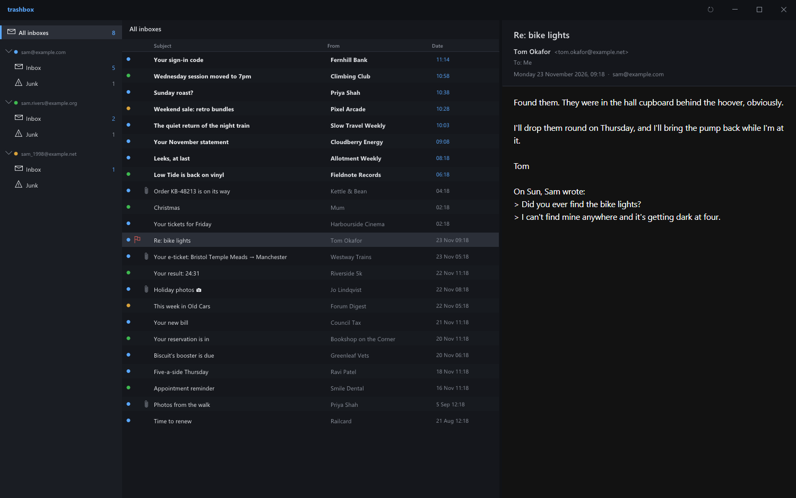
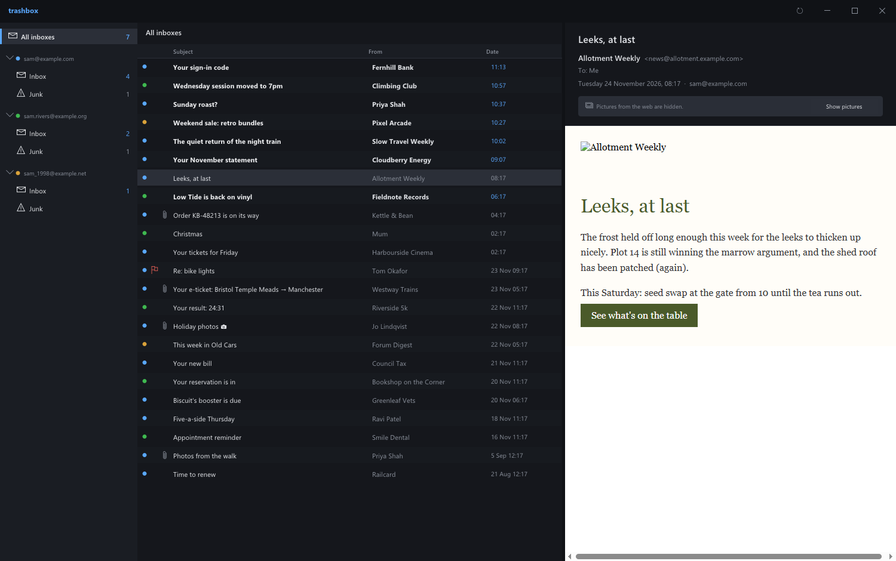
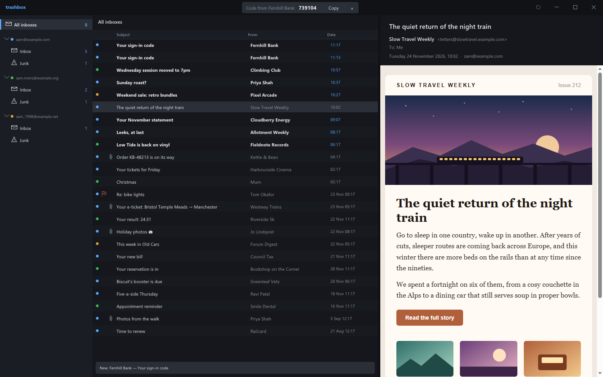

# trashbox

A small, fast mail client for Windows: every inbox in one list, mail
rendered properly, and nothing else. A native ImGui window with a WebView2
reading pane, driven by a Go engine that talks to Outlook (Microsoft Graph)
and Gmail (IMAP).

## What it does

- **One list for every account.** All inboxes together, or one folder at a
  time. Each account shows Inbox and Junk; right-click to show any other
  folder, and to move accounts up and down.
- **Real HTML mail, safely.** Messages render in WebView2 with scripts off.
  Pictures and anything else from the web are blocked until you ask for
  them, so senders can't tell when you've read their mail. Links open in
  your browser.
- **Plain text stays plain.** Text mail is shown in the app's own dark theme.
- **Live.** Gmail pushes new mail over IMAP IDLE; Outlook is polled with
  Graph delta queries. A local SQLite cache keeps it quick to open.
- **Sign-in codes.** When a verification or 2FA code arrives, trashbox spots
  it with plain rules (no AI, nothing leaves your PC to decide) and shows it
  in the title bar for 10 minutes, ready to copy. Promo codes, order
  numbers and sign-in links are left alone. It can also post each code to
  a webhook (`trashbox-engine spike set-codes-hook`, URL on stdin), for
  example to get it on your phone.
- **Small.** Mail is opened read when you open it, a draggable divider sets
  the list and reading pane sizes, and it sits in the tray when closed.

| Plain text | Pictures blocked | A sign-in code |
| --- | --- | --- |
|  |  |  |

Work in progress: reading works. Archive, delete, search and saving
attachments are next, then reply and compose.

## Accounts

- **Outlook / Hotmail / Live**: through Microsoft Graph, signed in with
  your browser. You need your own app registration in Microsoft Entra
  (public client, "Any Entra ID tenant + personal Microsoft accounts",
  redirect URI `http://localhost`, delegated `Mail.ReadWrite`, `Mail.Send`,
  `User.Read`, `offline_access`). Then:

      trashbox-engine spike set-client-id <application id>
      trashbox-engine spike outlook-login

- **Gmail**: IMAP and SMTP with an
  [app password](https://myaccount.google.com/apppasswords). Windows' own
  credential dialog asks for it:

      trashbox-engine spike gmail-add

Tokens and passwords are kept in `%LOCALAPPDATA%\trashbox\secrets`,
encrypted with Windows DPAPI for your user account.

## Building

The window needs Visual Studio 2022 (or its Build Tools) with the C++
workload, and the WebView2 SDK, which `tools/fetch-webview2.sh` downloads
from NuGet into `deps/`. Then:

    build.bat

The engine is Go (1.26):

    cd engine
    GOOS=windows CGO_ENABLED=0 go build -ldflags "-s -w -H=windowsgui" -o ../build/trashbox-engine.exe .
    go test ./...

Put `trashbox.exe` and `trashbox-engine.exe` side by side and run
`trashbox.exe`.

## Demo

`scripts/demo.ps1` opens trashbox on three made-up accounts (no sign-in, no
network), and `scripts/demo.ps1 -Shots docs` retakes the screenshots above.
Everyone and everything in it is invented.

## Thanks

[Dear ImGui](https://github.com/ocornut/imgui),
[nlohmann/json](https://github.com/nlohmann/json),
[go-imap](https://github.com/emersion/go-imap),
[modernc.org/sqlite](https://gitlab.com/cznic/sqlite).
